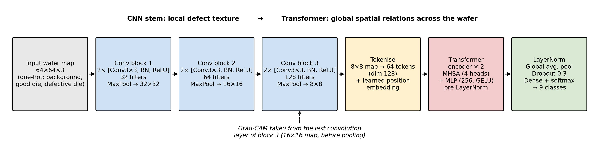
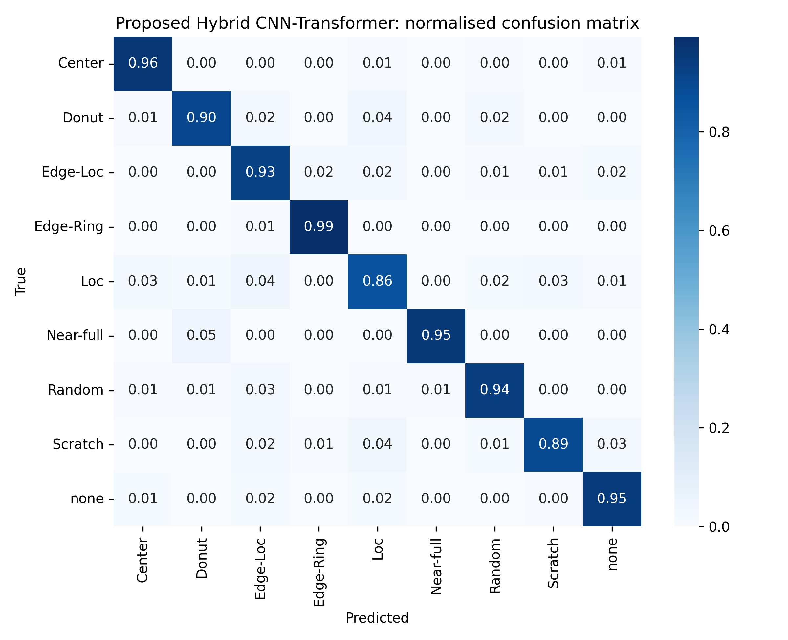
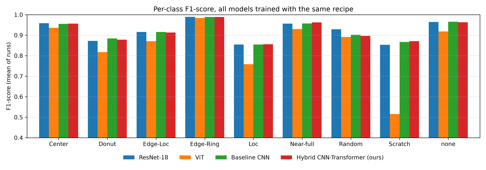
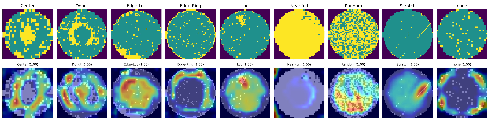

# Wafer Defect Classification with a Lightweight Hybrid CNN-Transformer

Classifies semiconductor wafer maps from the **WM-811K** dataset into 9 classes (Center, Donut, Edge-Loc, Edge-Ring, Loc, Near-full, Random, Scratch, none) using a small hybrid **CNN + Transformer** model, with **Grad-CAM** to show which part of the wafer drove each prediction.

The hybrid matches a standard CNN and ResNet-18 on accuracy while using **2.1x fewer parameters than the CNN and 20x fewer than ResNet-18**.



## Results (test set, same training recipe for all models)

| Model | Runs | Params | Size | Accuracy | Macro F1 |
|---|---|---|---|---|---|
| **Hybrid CNN-Transformer (ours)** | 3 seeds | **0.56 M** | **6.98 MB** | 94.48 ± 0.17 % | 0.921 ± 0.002 |
| Baseline CNN | 3 seeds | 1.21 M | 14.61 MB | 94.59 ± 0.29 % | 0.921 ± 0.006 |
| ResNet-18 | 1 | 11.18 M | 134.41 MB | 94.61 % | 0.922 |
| ViT (same size) | 1 | 0.56 M | 7.03 MB | 89.71 % | 0.847 |

- Accuracy is a statistical tie with the CNN and ResNet-18, at a fraction of the size.
- Lowest variance across seeds of all models.
- About 5 points better than a ViT of the same size (Scratch F1 0.87 vs 0.52).

Full per-seed and per-class numbers: [`results/all_runs.csv`](results/all_runs.csv)

| Confusion matrix | Per-class F1 |
|---|---|
|  |  |

### Grad-CAM



## Method

- **Data:** WM-811K (labelled wafers only), resized to 64x64, stratified train/val/test split.
- **Model:** CNN stem for local defect features, followed by Transformer encoder blocks for global wafer context, then a classification head.
- **Training:** rotation and flip augmentation, square-root class weights for the imbalanced classes, early stopping (patience 10), seeds 42/43/44.
- **Explainability:** Grad-CAM on the last convolutional layer.

## Repository layout

```
notebooks/
  01_Data_EDA_Baseline_CNN.ipynb          data loading, EDA, baseline CNN
  02_Hybrid_CNN_Transformer_GradCAM.ipynb hybrid model, ResNet-18, ViT, Grad-CAM
  03_Augmentation_Class_Weights.ipynb     improved training recipe
  04_Final_Comparison_3_Seeds.ipynb       3-seed comparison, final tables
results/                                  CSV tables of all runs
figures/                                  architecture, confusion matrix, F1, Grad-CAM
demo/                                     Gradio app with trained model and sample wafers
```

## Run it

**Notebooks:** open any notebook in Google Colab (T4 GPU) and run all cells. The dataset downloads automatically from Kaggle (`qingyi/wm811k-wafer-map`).

**Demo:**
```bash
cd demo
pip install -r requirements.txt
python app.py
```

## Tech stack

Python, TensorFlow / Keras, scikit-learn, NumPy, Pandas, Matplotlib, Gradio, Google Colab

## Author

**Rahul Dayanand Gunari**, B.E. Electronics and Communication Engineering, Sri Venkateshwara College of Engineering, Bengaluru (VTU)
gunarirahuld@gmail.com
